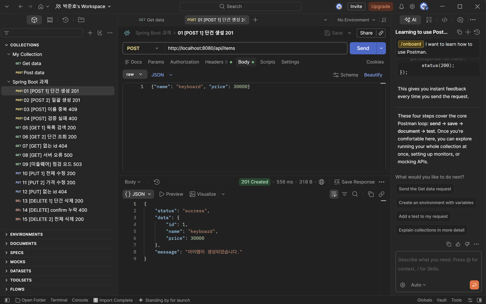
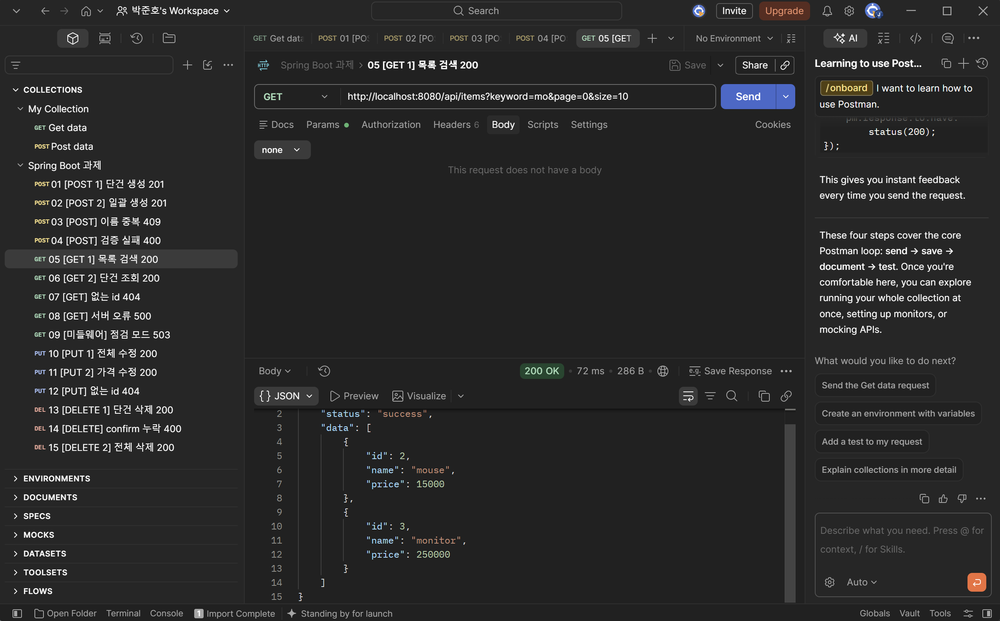
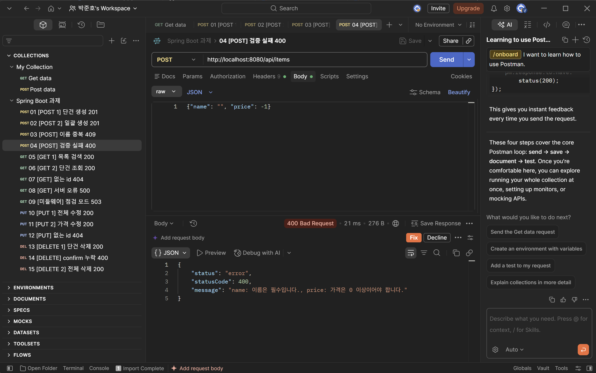
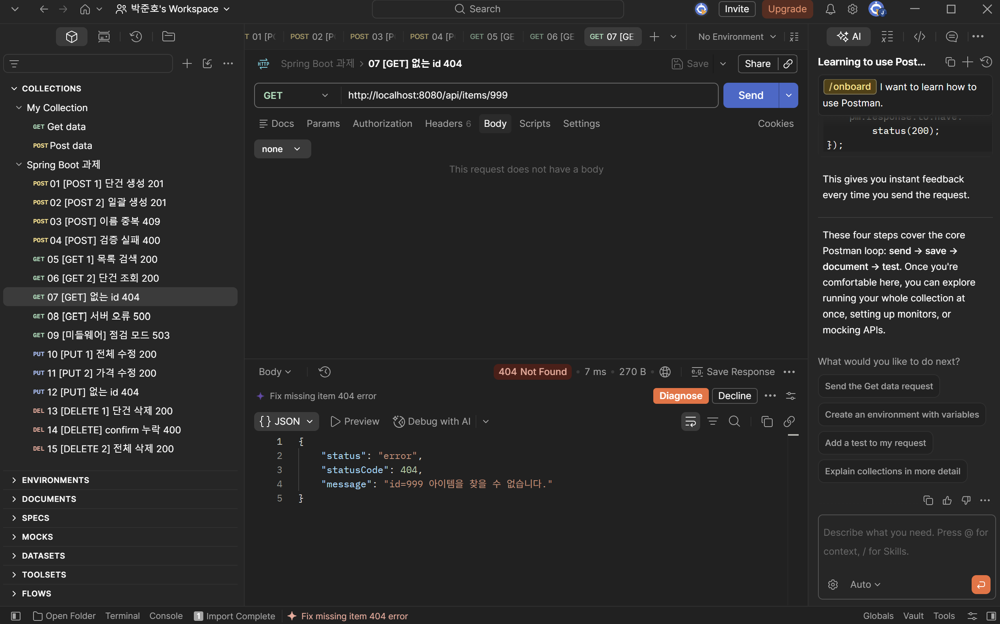
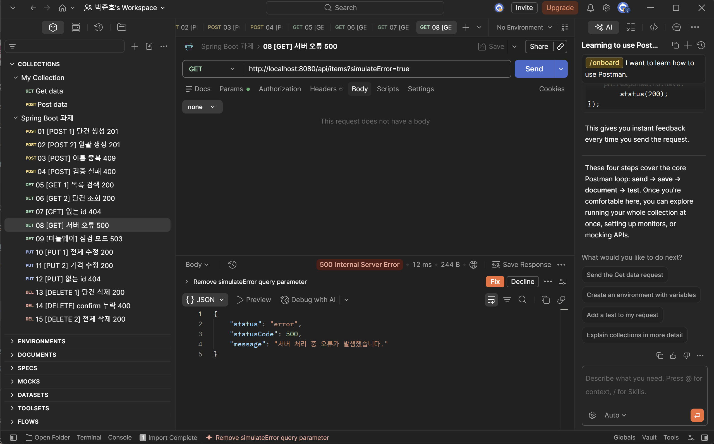
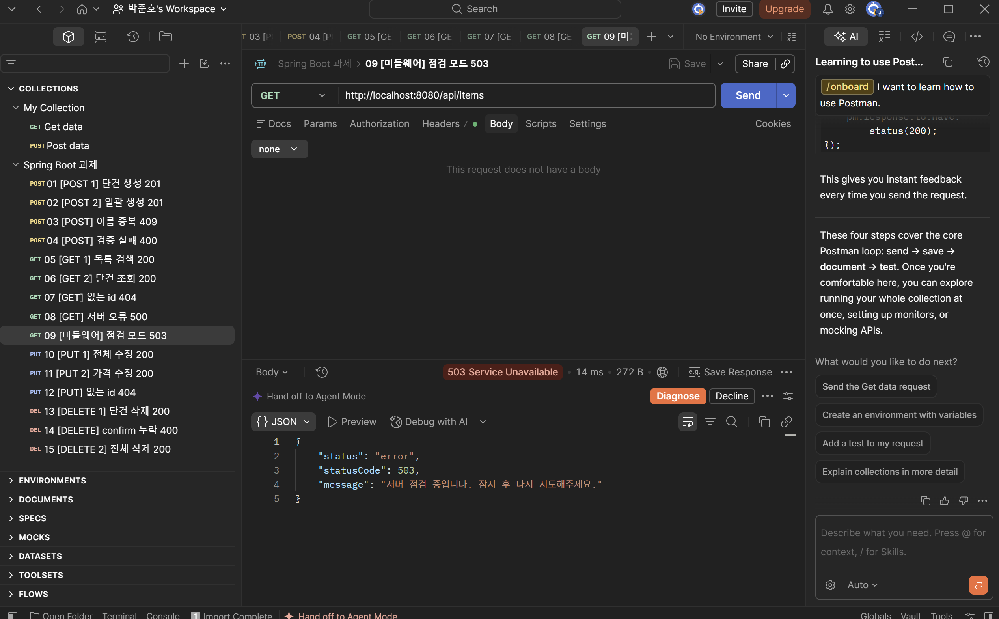
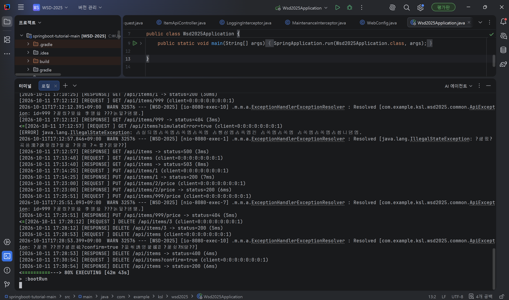

# Spring Boot REST API 실습 과제

인메모리 Item CRUD API — HTTP 메소드별 2개씩 총 8개 API, 미들웨어 2종, 다양한 응답 코드, 표준 응답 포맷 구현

## 실행 방법
1. JDK 21 환경에서 `./gradlew bootRun` → http://localhost:8080

## 프로젝트 구조
```
com.example.ksl.wsd2025
├── api
│   ├── item/ItemApiController.java     # API 8개
│   ├── dto/ItemDto.java
│   └── request/                        # 요청 DTO + @Valid 검증
├── common
│   ├── ApiResponse.java                # 표준 응답 포맷
│   ├── ApiException.java               # 상태코드를 가진 예외
│   └── GlobalExceptionHandler.java     # 모든 예외 → 표준 포맷
└── config
    ├── LoggingInterceptor.java         # 미들웨어 1: 요청/응답 로그
    ├── MaintenanceInterceptor.java     # 미들웨어 2: 점검 모드 503
    └── WebConfig.java                  # 인터셉터 등록
```

## A. API 목록 (8개)
| Method | URL | 설명 | 응답 코드 |
|---|---|---|---|
| POST | /api/items | 단건 생성 | 201, 400, 409 |
| POST | /api/items/bulk | 일괄 생성 | 201, 400, 409 |
| GET | /api/items?keyword=&page=&size= | 목록/검색 | 200, 400, 500 |
| GET | /api/items/{id} | 단건 조회 | 200, 404 |
| PUT | /api/items/{id} | 전체 수정 | 200, 400, 404, 409 |
| PUT | /api/items/{id}/price | 가격 수정 | 200, 400, 404 |
| DELETE | /api/items/{id} | 단건 삭제 | 200, 404 |
| DELETE | /api/items?confirm=true | 전체 삭제 | 200, 400 |

## B. 미들웨어
1. **LoggingInterceptor**: 모든 `/api/**` 요청의 메소드·URI·IP, 응답 상태코드·처리시간(ms) 로그 출력
2. **MaintenanceInterceptor**: `X-Maintenance: true` 헤더 또는 `app.maintenance=true` 설정 시 컨트롤러 진입 전 503 반환

## C. 응답 코드
| 범주 | 코드 | 발생 조건 |
|---|---|---|
| 2xx | 200 OK | 조회·수정·삭제 성공 |
| 2xx | 201 Created | 생성 성공 (Location 헤더 포함) |
| 4xx | 400 Bad Request | 입력 검증 실패, 빈 목록, confirm 누락 |
| 4xx | 404 Not Found | 존재하지 않는 id |
| 4xx | 409 Conflict | 이름 중복 |
| 5xx | 500 Internal Server Error | 서버 예외 (`?simulateError=true`) |
| 5xx | 503 Service Unavailable | 점검 모드 |

## D. 표준 응답 포맷
성공응답
```json
{ "status": "success", "data": { "id": 1, "name": "keyboard", "price": 30000 } }
```
실패응답
```json
{ "status": "error", "statusCode": 404, "message": "id=999 아이템을 찾을 수 없습니다." }
```
- 성공: 과제 명세의 `{status, data}` 형식
- 실패: 강의의 `{statusCode, message}` 형식에 `status` 추가
- 모든 예외는 `GlobalExceptionHandler`에서 같은 포맷으로 변환, 500은 내부 오류 내용 미노출

## 실행 및 테스트 화면 (Postman)
### 서버 실행


| 생성 201 | 조회 200 |
|---|---|
|  |  |

| 검증 실패 400 | 없는 id 404 |
|---|---|
|  |  |

| 서버 오류 500 | 점검 모드 503 |
|---|---|
|  |  |

### 미들웨어 로그


> 전체 캡처(17장)는 `screenshots/` 폴더 참고
